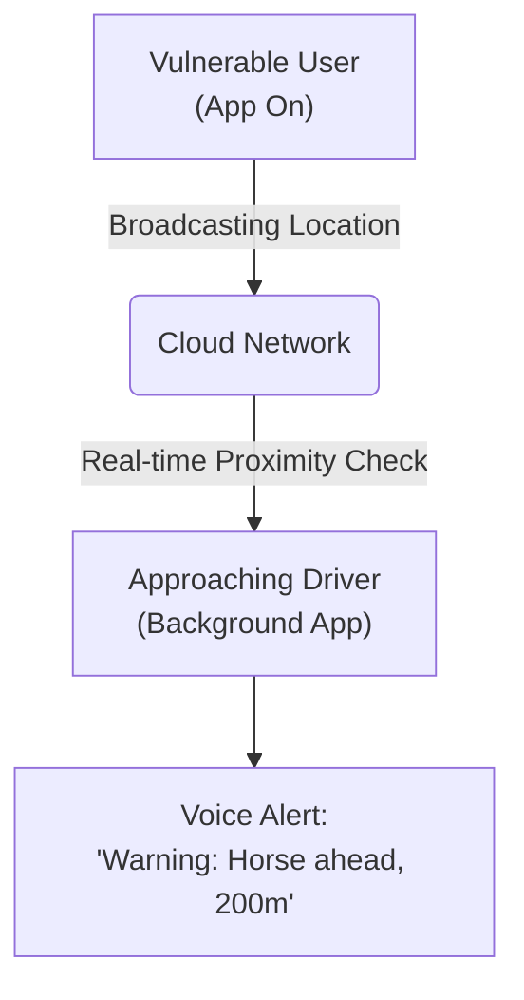

# Road Alert V2
### *A Digital Early-Warning Safety Shield for Rural Roads*

---

> [!NOTE]
> **Our Mission:** To prevent accidents and save lives on country lanes by giving drivers an "early warning shield" that detects horses, cyclists, and pedestrians before they come into view.

---

## 1. The Challenge on Our Roads
Rural country lanes are beautiful, but they present unique and severe hazards. Blind bends, high hedges, and sudden changes in visibility mean that drivers and vulnerable road users—especially horse riders, cyclists, and walkers—often don’t see one another until the last second. 

When a motorist rounds a corner and is suddenly forced to brake hard next to a horse or cyclist:
* It startles animals, putting riders in extreme danger.
* It risks vehicle collisions on narrow lanes.
* It places high stress on both drivers and vulnerable road users.

**High-visibility jackets only work if there is a direct line of sight. Road Alert is designed to see around the corners.**

---

## 2. What is Road Alert?
Road Alert is a simple, zero-config smartphone safety system. It acts as a **digital high-vis jacket**, broadcasting a silent safety signal from vulnerable road users directly to the navigation or alert systems of approaching vehicles.

---

## 3. How It Works (Simple App-to-App)

1. **Step 1: The Vulnerable Road User**
   Before setting off, a horse rider, cyclist, walker, or runner opens the Road Alert app on their phone and taps **START**. The app sits in their pocket or mount, silently sharing their location as they travel.
2. **Step 2: The Driver**
   Local drivers and delivery fleets run the Road Alert app in the background of their phones or dashboard systems. It is "set-and-forget"—running silently and consuming minimal battery.
3. **Step 3: The Early Warning**
   As a vehicle approaches a horse rider or cyclist, the driver's phone detects the proximity and plays a clear, friendly spoken audio alert:
   > 📢 *"Warning. Horse ahead. 200 meters."*
   
   This gives the driver plenty of time to lift off the accelerator, slow down, and safely pass wide and slow.

---

## 4. Key Benefits for Stakeholders

| Audience | The Benefit | Why Support Road Alert? |
| :--- | :--- | :--- |
| **Horse Riders & VRUs** | **Ultimate Peace of Mind** | Protects you and your animal *before* a vehicle rounds a blind bend. Prevents terrifying near-misses. |
| **Fleet & Delivery Drivers** | **Professional Safety** | Prevents blind-bend collisions, protects fleet vehicles, and reduces driver stress on rural routes. |
| **Local Communities** | **Safer Rural Infrastructure** | Creates a safer environment for rural tourism, stables, agricultural workers, and families. |

---

## 5. Frequently Asked Questions

#### **Is it power efficient?**
Yes. Both apps run on advanced location-sensing technology (Fused Location Services) that intelligently shares GPS data and conserves battery under the hood.

#### **Does it require complex setup?**
No. The motorist app is completely **zero-configuration**. Drivers just install it, and it works silently in the background, only speaking when a vulnerable user is nearby.

#### **How can companies support this?**
We are looking for fleet departments, local delivery firms, and rural organisations to trial the driver-side application with their drivers, helping us establish a safer road network for everyone.

---

## 6. Project Demos & Videos
*Below are links to the system in action (filmed in real-time demonstrating the early-warning alerts):*

> [!TIP]
> **[Optional: Insert Link to Demo Video 1 (e.g., Horse Rider View)]**
> *Description of what the rider app looks like when active.*

> [!TIP]
> **[Optional: Insert Link to Demo Video 2 (e.g., Motorist Audio Alert in Action)]**
> *Description of the driver receiving the audio warning before rounding a bend.*

---

*For more information, partnerships, or to join the trial, please contact:*
**Adam**  
*Project Lead, Road Alert V2*
